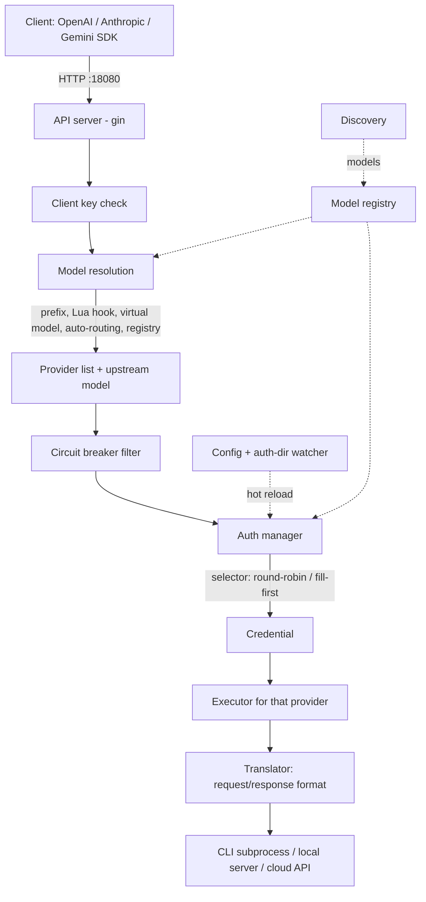

## Overview

switchAILocal is a single Go binary that exposes OpenAI-, Anthropic- and Gemini-compatible HTTP APIs and forwards each request to one of many backends: local CLI tools, local model servers, or cloud APIs. Everything runs in one process on your machine; there is no external database unless you opt into a remote token store.



## Components

| Component | Code | Role |
|-----------|------|------|
| API server | `internal/api/server.go` | Routes (`/v1/*`, `/openai/v1/*`, `/v1beta/*`, `/v0/management/*`, `/v1/ws`), CORS, auth middleware, management dashboard. |
| Request handlers | `sdk/api/handlers` | Parse the request, resolve the model, call the auth manager, stream or return the response, rewrite the public model name. |
| Model registry | `internal/registry` | Which credential (client) serves which model ID; feeds `/v1/models` and routing. |
| Discovery | `internal/discovery` | Fetches model lists (Gemini CLI list, Ollama tags, OpenCode agents, `models-url`) into the registry, with an on-disk cache. |
| Auth manager | `sdk/switchailocal/auth/conductor.go` | Holds credentials and executors, selects a credential, retries, tracks per-model cooldowns, refreshes OAuth tokens. |
| Executors | `internal/runtime/executor` | One per provider family: `geminicli`, `gemini`, `vertex`, `claude`, `codex`, `qwen`, `iflow`, `antigravity`, `aistudio`, `ollama`, `lmstudio`, `opencode`, `vibe`, the generic OpenAI-compatible executor, and the local CLI executor. |
| Translators | `internal/translator`, `sdk/translator` | Convert between OpenAI Chat, OpenAI Responses, Claude Messages, Gemini, Gemini CLI, Codex and Antigravity formats in both directions. |
| Watcher | `internal/watcher` | Watches `config.yaml` and `auth-dir`; rebuilds credentials and executors on change. |
| Virtual model router | `internal/virtualmodels` | Capability-aware weighted pools. |
| Auto-routing | `internal/autoroute` | Scores candidates for `model: auto`. |
| Lua engine | `internal/plugin` | `on_request` / `on_response` hooks (Cortex Router and other plugins). |
| Performance | `internal/performance` | Circuit breaker, rate limiter, load shedding. |

## Request lifecycle

1. **Authentication.** The client key is checked against `api-keys` (Bearer, `x-api-key`, `x-goog-api-key`, `?key=`, `?auth_token=`).
2. **Model resolution.** In order: explicit `provider:` prefix, Lua `on_request` hook, virtual model, auto-routing for `auto`/`cortex`, registry lookup. Details in [Routing](/concepts/routing).
3. **Circuit breaker.** Providers with an open breaker are dropped (when enabled).
4. **Credential selection.** For each provider in order, the auth manager filters credentials by model support and cooldown and lets the selector pick one.
5. **Execution.** The provider's executor translates the request, applies [payload rules](/advanced/payload-injection) where that executor supports them, and calls the backend. Streams from OpenAI-compatible providers (and MiniMax music) pass through a watchdog that enforces first-byte and stall timeouts.
6. **Failure handling.** Errors are classified (rate limit, auth, transient, permanent, ...). Recoverable classes move on to the next credential/provider; terminal ones return immediately. See [Failover](/advanced/failover).
7. **Response.** The body is translated back to the client's format; for virtual models the `model` field is rewritten to the public name.

## State

- **Credentials** carry a status plus a per-model state map (`Unavailable`, `NextRetryAfter`, quota backoff level). One key can be cooling down for one model while serving others.
- **Rotation cursors** for round-robin and provider rotation are in memory.
- **Virtual model rotation** is persisted to `virtual_models_state.json` in the state directory (`SWITCHAI_STATE_DIR`, default `~/.switchailocal`). See [State Box](/advanced/state-box).
- **Token files and the discovery cache** live in `auth-dir` (default `~/.switchailocal`).

## Hot reload

On a `config.yaml` change the watcher diffs old and new config, re-synthesizes credentials from config blocks and token files, re-binds executors, re-registers models, and swaps the selector if `routing.strategy` changed. In-flight requests are not interrupted. Some subsystems (auto-routing candidates, the Lua engine, `openai-compatibility` discovery sources) are only built at startup; restart after changing them.

## Optional subsystems

These are off by default and documented separately:

- [Cortex Router](/intelligent-systems/cortex-router) (Lua plugin + `intelligence:` block)
- [Auto-routing](/guides/auto-routing-setup) (`auto-routing:`)
- [Virtual models](/advanced/virtual-models) (`virtual-models:`)
- [Memory](/intelligent-systems/memory), [Heartbeat](/intelligent-systems/heartbeat), [Hooks](/intelligent-systems/hooks), [Superbrain](/intelligent-systems/superbrain)
- [Notifications relay](/advanced/notifications)
- Observability: Prometheus metrics on `observability.metrics.path` and NDJSON request events (`observability.request-events`)

## Extension points (Go SDK)

When embedding switchAILocal as a library (`sdk/switchailocal`):

```go
type ProviderExecutor interface {
    Identifier() string
    Execute(ctx context.Context, auth *Auth, req executor.Request, opts executor.Options) (executor.Response, error)
    ExecuteStream(ctx context.Context, auth *Auth, req executor.Request, opts executor.Options) (<-chan executor.StreamChunk, error)
    Refresh(ctx context.Context, auth *Auth) (*Auth, error)
    CountTokens(ctx context.Context, auth *Auth, req executor.Request, opts executor.Options) (executor.Response, error)
}

type Selector interface {
    Pick(ctx context.Context, provider, model string, opts executor.Options, auths []*Auth) (*Auth, error)
}
```

- Register an executor with `service.CoreManager().RegisterExecutor(exec)`; its `Identifier()` becomes the provider ID.
- Replace the selector with `CoreManager().SetSelector(sel)`.
- Receive per-request usage records with `service.RegisterUsagePlugin(p)` where `p` implements `HandleUsage(ctx, usage.Record)`.

See [Embedding SDK](/sdk/embedding/overview) for a complete example.

## Next steps

<CardGroup cols={2}>
  <Card title="Providers" href="/concepts/providers" icon="plug">
    Provider families and how they are enabled
  </Card>
  <Card title="Routing" href="/concepts/routing" icon="route">
    Model resolution and credential selection
  </Card>
  <Card title="Authentication" href="/concepts/authentication" icon="key">
    Client keys, OAuth logins and token storage
  </Card>
  <Card title="Configuration" href="/configuration/overview" icon="gear">
    Configuration reference
  </Card>
</CardGroup>
