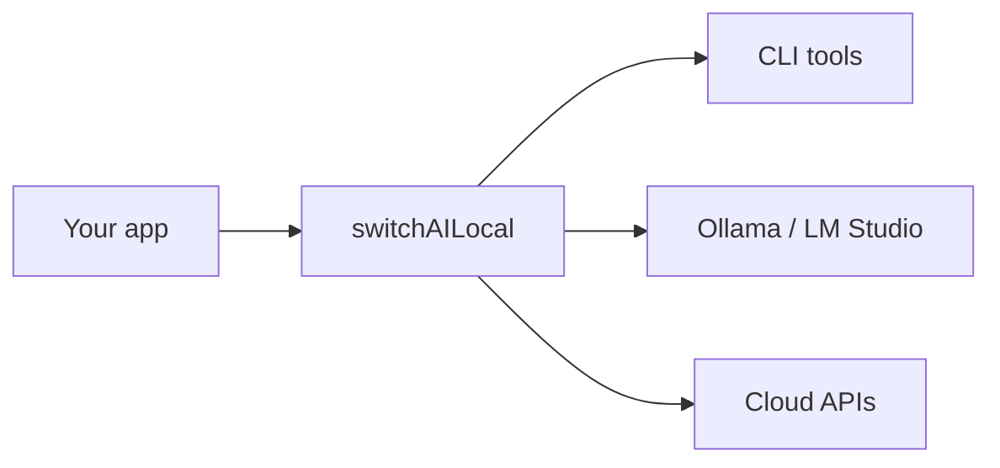

**switchAILocal** is a gateway that runs on your machine and exposes one
OpenAI-compatible API. Each request is forwarded to the provider you pick:
CLI tools you are already logged in to, local model servers, or cloud API keys.
Claude-compatible (`/v1/messages`) and Gemini-compatible (`/v1beta`) routes are
served on the same port.

```bash
./switchAILocal          # reads ./config.yaml, listens on the configured port
```

Point any OpenAI SDK or tool at `http://localhost:18080/v1` (the port used by
`config.example.yaml`) and use model names such as `geminicli:gemini-2.5-pro`
or `ollama:llama3.2`.

<CardGroup cols={2}>
  <Card title="Quickstart" icon="rocket" href="/quickstart">
    Run the server and make a first request
  </Card>
  <Card title="Installation" icon="download" href="/installation">
    Release archive, Docker, or build from source
  </Card>
  <Card title="Providers" icon="plug" href="/configuration/providers">
    Connect CLIs, local models and API keys
  </Card>
  <Card title="API Reference" icon="code" href="/api/overview">
    The OpenAI-compatible API
  </Card>
</CardGroup>

## What it does

<CardGroup cols={2}>
  <Card title="One endpoint" icon="network-wired">
    All providers behind one base URL and one client key
  </Card>
  <Card title="OpenAI compatible" icon="infinity">
    Works with OpenAI SDKs and tools without code changes
  </Card>
  <Card title="CLI subscriptions" icon="terminal">
    Logged-in `gemini`, `claude`, `codex` and `vibe` CLIs become providers
  </Card>
  <Card title="Local models" icon="server">
    Ollama, LM Studio and an OpenCode server
  </Card>
  <Card title="Routing and failover" icon="shield-halved">
    Prefixes, aliases, virtual models, circuit breakers and retries
  </Card>
  <Card title="Operations" icon="gauge">
    Management panel and API, Prometheus metrics, JSON logs
  </Card>
</CardGroup>

## Supported providers

### CLI tools

Detected automatically at startup when the binary is on `PATH`. The CLI's own
login is used; no keys go into `config.yaml`.

| Provider | Binary | Prefix |
| -------- | ------ | ------ |
| Google Gemini CLI | `gemini` | `geminicli:` |
| Anthropic Claude Code | `claude` | `claudecli:` |
| OpenAI Codex | `codex` | `codex:` |
| Mistral Vibe | `vibe` | `vibecli:` |

### Local servers

| Provider | Prefix | Config block |
| -------- | ------ | ------------ |
| Ollama | `ollama:` | `ollama` |
| LM Studio | `lmstudio:` | `lmstudio` |
| OpenCode (`opencode serve`) | `opencode:` | `opencode` |

### Cloud APIs

| Provider | Prefix | Config key |
| -------- | ------ | ---------- |
| Google AI Studio | `gemini:` | `gemini-api-key` |
| Anthropic API | `claude:` | `claude-api-key` |
| OpenAI API | `codex:` | `codex-api-key` |
| Traylinx switchAI | `switchai:` | `switchai-api-key` |
| Groq, OpenRouter, DeepSeek and any OpenAI-compatible API | your `prefix` | `openai-compatibility` |

OAuth logins for Gemini, Claude, Codex, Qwen, iFlow and Antigravity are also
available; see [Login commands](/cli/login).

## How a request flows



1. Your app sends an OpenAI-format request to `/v1/chat/completions`.
2. switchAILocal checks the client key against `api-keys`.
3. The `model` field selects the provider: an explicit `provider:model` prefix,
   an alias from `config.yaml`, a virtual model, or any provider that serves
   that model name.
4. The response comes back in the format of the route you called.

<Note>
  The gateway itself runs locally. Requests routed to CLI tools or cloud APIs
  are sent to those providers; requests routed to Ollama or LM Studio stay on
  your machine.
</Note>

## Next steps

<Steps>
  <Step title="Install">
    Follow the [installation guide](/installation).
  </Step>
  <Step title="Run the quickstart">
    Make your first request with the [quickstart](/quickstart).
  </Step>
  <Step title="Configure">
    Add providers and keys: [configuration overview](/configuration/overview).
  </Step>
  <Step title="Secure it">
    Set client keys and a management secret before exposing the port:
    [security](/configuration/security).
  </Step>
</Steps>

## Community

<CardGroup cols={2}>
  <Card title="GitHub Repository" icon="github" href="https://github.com/traylinx/switchAILocal">
    Source, releases and discussions
  </Card>
  <Card title="Report Issues" icon="bug" href="https://github.com/traylinx/switchAILocal/issues">
    Found a bug? Open an issue
  </Card>
</CardGroup>
